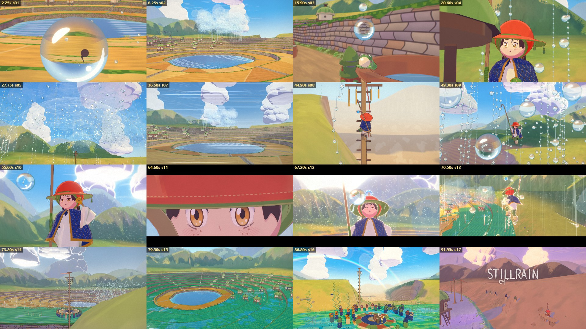

# STILLRAIN · 머문 비

*the valley where rain waits for a sound*

비가 제 음높이의 소리를 들어야만 떨어지는 고원 계곡에서, 가장 작은 견습 종지기 소녀가 계곡 끝으로 흘러가 버리는 비를 쫓아간다. 작은 종이 깨지자, 소녀는 자기 목소리로 하늘의 비를 내린다.

93초짜리 애니메이션 단편이다. HTML 파일 **하나**(`index.html`)가 브라우저에서 실시간으로 돌아가고, 표 한 장(`film/events.js`)이 비, 소리, 풀잎, 사람들을 함께 움직인다.



## 순수 three.js

- 라이브러리는 [three.js](https://threejs.org) r170 하나뿐이다. 페이지 안에 그대로 넣었고, 애드온, 후처리 패키지, 오디오 라이브러리는 쓰지 않는다.
- 에셋이 없다. 이미지, 모델, 폰트, 소리 파일이 하나도 없다. 메시, 텍스처, 셰이더, 움직임, 소리, 제목 글씨까지 모두 페이지가 열릴 때 코드로 만들어진다.
- 네트워크를 쓰지 않는다. `index.html`을 내려받아 디스크에서 바로 열면 된다.

## 보기

`index.html`을 WebGL 2가 되는 데스크톱 브라우저(Chrome, Edge 권장)로 연다. 로딩이 끝나면 화면을 한 번 누르거나 `Space`를 눌러 시작한다. 소리가 함께 나온다.

처음 열 때는 GPU가 셰이더 150개쯤을 하나씩 굽느라 15~20초쯤 걸린다. 브라우저가 구운 셰이더를 기억하기 때문에 두 번째부터는 5초 안팎이다. 걸리는 시간은 GPU에 따라 다르다.

| 입력 | 동작 |
|---|---|
| `Space` | 멈춤 / 재생 |
| `←` `→` | 앞뒤 장면으로 건너뛰기 |
| `R` | 처음부터 |
| `M` | 소리 끄기 |
| `2` | 인물 원화를 2콤마(초당 12장)로 그릴지, 매 프레임 그릴지 바꾸기 |
| `H`, `F` | 안내 숨기기, 전체 화면 |
| `?t=초` | 그 시점에서 바로 시작 (`&still`을 붙이면 멈춘 채로). 소리는 화면을 한 번 누르면 나온다 |
| `?voice=ocarina` | 노래하는 목소리를 오카리나 소리로 바꾸기 |

## 세계의 규칙

**머문 물.** 이 세계에서 공기 중에 맺힌 물은 저절로 떨어지지 않는다. 비는 유리구슬처럼 맺힌 자리에 매달려 있고, 바람에 밀려 찌르레기 떼처럼 흐르는 덩어리, **비 무리(rain-field)** 가 된다. 물방울은 제 음높이의 소리가 닿아야만 떨어진다.

| 층 | 크기 | 듣는 음 | 한 번 쳐서 떨어뜨리는 악기 |
|---|---|---|---|
| 굵은 비 (HEAVY) | 주먹~수박 크기 | D | 큰북 (D2) |
| 구슬비 (MARBLE) | 2~6 cm | A | 종 기둥의 청동 막대 (A4) |
| 안개비 (MIST) | 2~8 mm | E | 손종 (E6) |

옥타브가 다른 음은 1.5초 동안 끌어야 떨어뜨린다. 그 전까지 물방울은 점점 세게 떨기만 한다. 개구리의 긴 울음이나 콧노래가 그렇다.

**느린 소리.** 소리는 초속 30 m로 퍼진다. 그래서 음 하나가 비 무리를 건너가는 모습이, 물방울이 차례로 반짝이며 떨어지는 고리로 눈에 보인다. 테라스 건너편과 말을 주고받으면 한참 늦게 닿으니, 사람들은 손짓으로 이야기한다.

**잠깐 버티는 발판.** 주먹보다 큰 물방울은 가벼운 발걸음을 한 박자(0.75초) 동안 받쳐 준다. 젤리처럼 눌렸다가 출렁이고, 그다음 떨어진다. 멈추지만 않으면 아이가 빗방울을 징검다리 삼아 하늘을 건널 수 있다.

그래서 이 골짜기 사람들은 조용히 산다. 지붕은 펠트와 이끼로 두껍게 덮어 집 안의 말소리가 이슬비를 내리지 않게 하고, 종에는 장갑을 씌운다. 비 무리가 오면 종지기들이 종과 북을 울려 비를 내리고, 부채꾼들이 3 m짜리 펠트 부채로 바람을 일으켜 무리를 몰고, 노인들은 하루 종일 골짜기 가장자리에 앉아 천둥 소리를 기다린다.

## 이야기

| 장면 | 시간 | 무슨 일이 |
|---|---|---|
| s01 물방울 하나 | 0–6 | 물방울 하나 안에 거꾸로 선 골짜기. 그 뒤로 수천 개의 물방울이 매달려 있다 |
| s02–s03 쉿, 의 마을 | 6–18 | 손짓으로 말하는 마을. 아이의 장난감 종이 작은 이슬비를 내리고, 개구리가 긴 울음으로 물방울을 받아먹는다 |
| s04 코끝의 비 | 18–24 | 펠의 콧노래가 D로 내려앉아 물방울이 코끝에 떨어진다. 던 할머니가 쉿, 너는 아직이라고 손짓한다 |
| s05–s06 울림 | 24–36 | 부채꾼들이 비 무리를 몰고, 27초에 큰북이 울린다. 굵은 비가 고리를 그리며 떨어지고, 종 기둥과 지붕 종이 차례로 뒤따른다 |
| s07 돌풍 | 36–42 | 돌풍이 비 무리를 골짜기 끝으로 밀어낸다 |
| s08–s09 달리기, 징검다리 | 42–54 | 펠이 오두막 지붕을 딛고 종 기둥을 기어올라, 빗방울을 징검다리 삼아 하늘로 뛰어오른다 |
| s10 종 | 54–60 | 비 무리 한가운데서 손종을 흔들다 종이 깨진다. 소리가 사라진다 |
| s11 마(間) | 60–66 | 침묵. 화면이 2.39:1로 좁아지고, 카메라가 그녀의 눈까지 다가간다 |
| s12 한 음 | 66–69 | 펠이 자기 목소리로 A, 그리고 D를 노래한다. 비 무리 전체가 그 소리를 듣는다 |
| s13–s14 떨어지는 계단, 장막 | 69–75 | 함께 떨어지는 비 사이를 달려 내려온다. 은빛 장막이 골짜기를 덮고, 마을 사람들이 펠트 천으로 그녀를 받아 낸다 |
| s15–s16 초록 홍수, 소리를 내도 좋은 날 | 75–87 | 테라스가 위에서부터 차례로 초록으로 물든다. 처음으로 모두가 웃고 떠든다. 무지개 |
| s17 머문 비 | 87–93 | 해 질 녘 벤치. 콧노래에 마지막 물방울 하나가 손바닥으로 떨어지고, 제목이 붓으로 써진다 |

## 표 한 장이 모든 것을 움직인다

`film/events.js`의 울림 표(종, 북, 개구리, 콧노래, 노래, 톡의 지저귐까지 22개)에 시각, 음높이, 소리가 닿는 거리, 위치가 적혀 있다.

- 물방울마다 떨어지는 시각은 `소리 시각 + 거리 / 30 m/s + 버티는 시간`이라는 한 공식으로 정해진다(방울마다 0.08초 안에서 조금씩 흩어진다). JS와 GLSL에 같은 식이 있고, 영화의 모든 것이 이 식 하나를 따른다.
- `film/rain.js`가 15만여 개의 물방울을 이 식대로 매달았다가 떨어뜨린다. 떨어지는 모양은 공기 저항이 있는 낙하(`y = -(Vt²/g)·ln cosh(g·τ/Vt)`)다.
- `music/synth.js`는 같은 표로 소리를 만든다. 울림마다 귀(그 장면의 주인공) 가까이에서 떨어지는 물방울을 최대 60개 골라, 그림에서 떨어지는 바로 그 순간에 맑은 '똑' 소리를 낸다.
- `film/life.js`의 잎은 지나가는 소리 쪽으로 고개를 돌리고, 펠(`film/cast.js`)과 마을 사람들(`film/crowd.js`)의 술 장식이 그 소리에 떤다.

모든 움직임은 영화 시각의 함수다. 아무 시점으로 건너뛰어도 같은 장면이 나온다.

## 애니처럼 보이게

- **셀 셰이딩**: 빛을 계단으로 나눈다. 배경, 소품, 마을 사람들은 밝음과 그림자 두 단계, 주요 인물 셋(펠, 톡, 던)은 중간 단계를 더한 세 단계다. 그림자는 회색으로 빠지지 않고 장미빛·보랏빛으로 색이 바뀐다.
- **잉크 선**: 화면 폭이 일정한 외곽선과, 깊이 차이에서 그리는 선을 함께 쓴다.
- **움직임**: 인물은 2콤마(초당 12장)로 움직이고, 카메라와 물과 빛은 매 프레임 움직인다. 빠른 동작에는 스미어 프레임이 들어가고, 종이 깨질 때와 첫 음에는 두 색으로 칠한 임팩트 프레임이 들어간다. 돌풍과 질주에는 가로, 낙하에는 세로 속도선이 그어진다.
- **배경**: 하늘과 구름은 손으로 칠한 것처럼 그렸다. 구름 그림자 안에는 망점이 찍힌다.
- **물방울**: 진짜 유리처럼 뒤의 풍경을 거꾸로 비춘다.
- **후처리**: 블룸, 빛줄기, 렌즈 플레어, 빛 번짐, 피사계 심도, 종이 질감과 그레인, 장면마다 다른 색 보정이 들어간다.

## 어떻게 짰나

- **시간의 함수.** 어떤 값도 지난 프레임을 기억하지 않는다. 물방울, 망토 자락, 카메라, 소리가 모두 영화 시각 `t`만으로 정해지고, 난수도 이름 붙은 시드에서 나온다. 그래서 건너뛰기, 정지 화면, 프레임 단위 녹화가 모두 같은 그림을 만든다.
- **표 하나, 식 두 벌.** 울림 표와 떨어지는 공식이 JS와 GLSL에 같은 모양으로 있다. JS는 방울마다 시각을 미리 셈하고 소리를 예약하며, 셰이더는 같은 낙하 식과 같은 표로 방울과 잎을 움직인다.
- **움직임은 셰이더에서.** 방울, 잎, 문 커튼, 종은 JS가 자리와 시각만 정하고 정점 셰이더가 움직인다.
- **빚은 인물.** 인물은 SDF 부품을 부드럽게 합쳐 surface nets로 메시를 만들고, 뼈 15개와 IK로 움직인다. 얼굴은 텍스처 없이 셰이더가 그린다.
- **미리 쓴 악보.** 모든 소리를 큐 시트로 미리 계산해 두고 Web Audio로 예약한다. 소리가 나는 동안에는 오디오 시계가 그림을 이끈다.
- **장면은 카메라만.** 장면 파일 17개는 카메라와 화면 설정만 돌려주고, 나머지는 모듈이 시각을 보고 알아서 움직인다.

코드를 따라 읽는 해설은 [docs/CODE.md](docs/CODE.md)에 있다.

## 파일

구성은 [ChetasLua/bide](https://github.com/ChetasLua/bide)처럼 `film/`(그림), `music/`(소리), `tools/`(빌드와 확인 도구)로 나누고, 장면은 파일 하나에 하나씩 둔다. `tools/build.py`가 전부를 HTML 한 장으로 묶는다.

| 파일 | 하는 일 |
|---|---|
| [`docs/CODE.md`](docs/CODE.md) | 코드 해설: 구조, 시간, 울림 표, 렌더링, 모듈별 기법, 확인 도구 |
| `film/BIBLE.md` | 세계관, 규칙, 인물, 17개 장면, 동작, 색 설계 (영문) |
| `film/CONTRACT.md` | 모듈마다 맡은 파일, 공용 API, 시간·프레임 예산 |
| `film/anim.js` | 시간 도구: 키프레임, 이징, 스프링, 2콤마, 잡음, 시드 난수 |
| `film/engine.js` | 렌더러: 셀 재질, 외곽선, 하늘, 구름, 유리, 그림자, 후처리 전체 |
| `film/sculpt.js` | SDF로 모양을 빚어 메시로 바꾸는 도구 (인물, 개구리) |
| `film/valley.js` | 계단식 골짜기의 땅 모양과 장소들 (JS와 GLSL) |
| `film/path.js` | 비 무리의 이동, 펠과 던의 동선, 징검다리 물방울 |
| `film/events.js` | 울림 표와 떨어지는 시각 공식 (JS와 GLSL) |
| `film/stub.js` | `world.js`를 빼고 빌드할 때 대신 그리는 임시 골짜기 |
| `film/world.js` + `WORLD.md` | 땅, 테라스, 마을, 종 기둥, 하늘, 빛의 시간표, 초록 홍수 |
| `film/rain.js` + `RAIN.md` | 비 무리, 물방울 줄, 큰 유리 물방울, 소리의 고리 |
| `film/cast.js` + `CAST.md` | 펠, 톡(새), 던 할머니: 몸, 얼굴, 표정, 옷자락, 소품 |
| `film/life.js`, `crowd.js` + `LIFE.md` | 잎, 갈대, 싹, 덩굴, 개구리, 새, 나방, 마을 사람들 |
| `film/camera.js` | 카메라 도구: 렌즈, 궤도, 손떨림 |
| `film/scenes/s01–s17.js` | 장면 하나에 파일 하나: 카메라, 연기 지시, 화면 설정 |
| `film/titles.js` | 붓으로 쓰는 제목 (획마다 코드로 그린다) |
| `film/main.js` | 로딩, 재생, 키 입력, 녹화, 확인 도구(`FILM.dev`) |
| `music/score.js` | 템포, 장면 시각표, 장면별 색 보정 |
| `music/synth.js` + `SOUND.md` | Web Audio로 만든 소리 전부: 북, 종, 목소리, 개구리, 빗소리 |
| `tools/build.py` | 모든 파일을 `dist/stillrain.html` 하나로 묶고 `index.html`로 복사 |
| `tools/shot.mjs` | 헤드리스 Chrome으로 아무 시각의 화면을 찍는다 (실제 GPU) |
| `tools/listen.mjs` | 소리를 WAV로 렌더하고 음량, 클릭, 스펙트럼을 잰다 |
| `tools/record.py` | 영화를 프레임 단위로 녹화해 MP4로 만든다 (ffmpeg 필요) |

## 만들기와 확인

빌드는 Python 3 표준 라이브러리만 쓴다. `--check`에는 Node가, `shot.mjs`와 `listen.mjs`에는 Node 22 이상과 Chrome(또는 Edge)이, 녹화에는 ffmpeg가 필요하다.

```sh
python tools/build.py --check          # 묶기 (+ 파일마다 node --check)
node tools/shot.mjs --t 27.75 --w 1280 --out build/a.jpg          # 한 장면 찍기
node tools/shot.mjs --t 2,22.4,49.3,67.2 --cols 2 --out build/b.jpg   # 여러 시각을 한 장에
node tools/shot.mjs --test release --k 0,1,2,3 --cols 2 --out build/c.jpg   # 모듈의 시험 화면 (valley, field, pell, frog ...)
node tools/listen.mjs --out build/sound.wav --clicks                 # 소리를 WAV로 렌더하고 음량, 클릭을 잰다
python tools/record.py                 # 녹화 서버. 그다음 http://127.0.0.1:8792/dist/stillrain.html?rec=1920x1080&fps=30 을 열면 out/stillrain.mp4
```

브라우저 콘솔에서 `FILM.dev.sweep()`을 부르면 영화 전체를 훑으며 카메라가 땅이나 집, 펠의 몸이나 후드 챙 속에 들어가거나 펠이 화면 밖으로 나가는 순간을 찾는다. 지금은 0건이다.

RTX 2070 Max-Q, 1080p 기준으로 한 프레임에 7~11 ms가 든다. 전체 소리는 -16.5 LUFS, 최대 -1.8 dBFS이고 클릭 잡음은 없다.

## 출처와 고마움

hobby-programmer-5000이 Claude(Anthropic)와 함께 Claude Code로 만들었다.

- [three.js](https://threejs.org) r170, MIT 라이선스 (`vendor/LICENSE`)
- [ChetasLua/bide](https://github.com/ChetasLua/bide), MIT 라이선스 (`vendor/bide-LICENSE`): 파일 구성과 장면 하나에 파일 하나라는 방식을 본떴다. `film/anim.js`의 `keys`, 이징 모음, `mixv`, `hash`, `spline`은 bide의 `film/anim.js`를 따라 썼다. 임시 골짜기(`film/stub.js`), 파일마다 `<script>`를 따로 두는 빌드 규칙, 뼈대의 캡슐을 한 덩어리로 합친다는 조각의 생각(`film/sculpt.js`)도 bide에서 왔다.
- 계기: chetaslua의 X 게시물(The Tea Ride). 순수 코드 + three.js로 애니풍 영화를 만든다는 발상만 빌렸다. 세계관, 인물, 그림, 소리는 모두 새로 만들었다.
- `film/sculpt.js`와 `tools/record.py`는 같은 작업자의 이전 작품 Tidelight에서 가져왔다.

## 라이선스

이 저장소의 모든 것(코드, 문서, `docs/`의 이미지, 코드가 만드는 그림과 소리)은 MIT 라이선스다. Copyright (c) 2026 hobby-programmer-5000. 전문은 [`LICENSE`](LICENSE)에 있다.

`vendor/three.module.min.js`(three.js)와 bide에서 따라 쓴 부분은 각자의 MIT 고지를 그대로 지닌다: [`vendor/LICENSE`](vendor/LICENSE)(three.js authors), [`vendor/bide-LICENSE`](vendor/bide-LICENSE)(ChetasLua).
